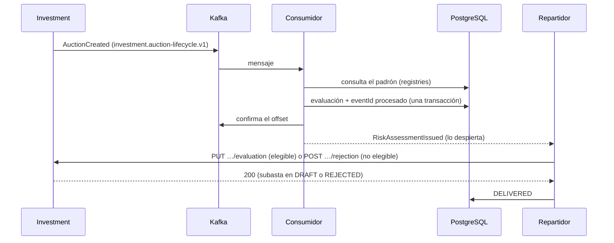

# Arquitectura

## Contextos

Cuatro contextos acotados, cada uno con las cuatro capas de la skill `ddd-fastapi`:

- `assessments` decide sobre cada subasta.
- `registries` guarda la copia local de los padrones de SUNAT y de las listas de sanciones (SUNAT, OECE, OEFA).
- `sustainability` decide si una MYPE es verde a partir del certificado que subió a su perfil.
- `verification` comprueba que una MYPE es quien dice ser (su KYC) con su ficha RUC firmada por SUNAT.

Un contexto le pregunta a otro solo por su fachada (`interfaces/acl.py`), a través de su propio `application/acl.py`, que es el único módulo que la importa. `assessments` pregunta a `registries` por el pagador y a `sustainability` por la MYPE; `sustainability` pregunta a `registries` por la razón social y por OEFA, y `verification` por el padrón, la SSCO y las demás sanciones.

### `assessments`

| Capa | Qué hay |
|---|---|
| `domain/` | El agregado `RiskAssessment`, sus value objects (`Ruc`, `RiskGrade`, `PayerStanding`, `ScoreFactor`, `GradingDecision`…), el evento `RiskAssessmentIssued` y la política `PointsGradingPolicy` |
| `application/` | `RiskAssessmentApplicationService` (evaluar, entregar, leer), el puerto `AuctionEvaluationService` hacia Investment (calificar o rechazar), el puerto `CreditBureau` (la central de riesgos), el puerto `NewsScreener` (noticias negativas) y `ExternalRegistriesService` (la ACL hacia `registries`) |
| `infrastructure/` | Tablas, repositorio SQLAlchemy, el adaptador httpx de Investment y `SimulatedCreditBureau` (la única pieza **simulada** del servicio) y `OpenAINewsScreener` (búsqueda web con `gpt-6-luna`, con caché de 7 días en `news_screenings`) |
| `interfaces/` | Consumidor de Kafka, repartidor, rutas REST y el parser del contrato |

### `registries`

| Capa | Qué hay |
|---|---|
| `domain/` | `RegistrySnapshot` (qué versión de cada fuente está cargada) y un registro por fuente (`TaxpayerRecord`, `AgentRecord`, `ShellCompanyRecord`, `CoactiveDebtorRecord`, `OeceSanctionRecord`, `EnvironmentalOffenderRecord`) |
| `application/` | `RegistryRefreshService`: compara la versión publicada (`Last-Modified`) con la cargada y, si cambió, descarga y reemplaza |
| `infrastructure/` | Lectores de cada formato (`parsers.py`: TXT latin-1, CSV, XLSX, JSON), descarga con httpx y carga masiva con `COPY` e intercambio atómico de tablas (`bulk.py`) |
| `interfaces/` | La fachada para `assessments`, el comando `python -m registries refresh` y el programador diario |

La carga del padrón (1,6 GB, unos 18 M de filas) corre siempre en **otro proceso**, nunca en el bucle de eventos de la API. Escribe en una tabla nueva y la intercambia por la vieja en la misma transacción: hasta el commit se sigue leyendo la copia anterior, y si algo falla queda intacta.

### `sustainability`

| Capa | Qué hay |
|---|---|
| `domain/` | El agregado `GreenCertification` (la decisión sobre una subida, con cada regla y su resultado), sus value objects (`CertificateDocument`, `CertificateExtraction`, `CriterionResult`, `Mype`…), el evento `GreenCertificationDecided` y la política `GreenCertificationPolicy` (`green-v1`) |
| `application/` | `GreenCertificationApplicationService` (decidir sobre un certificado), `GreenCertificationQueryService` (si una MYPE es verde un día dado), los puertos `CertificateDocuments`, `CertificateReader` y `GreenCertificationPublisher`, y la ACL hacia `registries` |
| `infrastructure/` | Tabla `green_certifications`, la descarga con httpx desde el bucket de Profile, `OpenAICertificateReader` (`gpt-6-luna` con el archivo en base64) y el publicador que escribe en el outbox |
| `interfaces/` | El consumidor de `vankoo.profile.events`, el parser de `SustainabilityCertificateSubmitted` y la fachada `green_status` para `assessments` |

La IA solo transcribe el certificado y las reglas deciden. Comprueba coherencia con SUNAT y OEFA, no autenticidad: ver [GREEN_RULES.md](GREEN_RULES.md).

### `verification`

| Capa | Qué hay |
|---|---|
| `domain/` | El agregado `CompanyVerification` (la decisión sobre una solicitud, con cada regla y su resultado), sus value objects (`Applicant`, `RucDocument`, `RucDocumentInspection`, `TaxpayerStanding`, `CheckResult`, `FieldError`, `Evidence`…), el evento `CompanyVerificationDecided` y la política `KycPolicy` (`kyc-v1`) |
| `application/` | `CompanyVerificationApplicationService` (verificar una solicitud), los puertos `RucDocuments`, `RucDocumentInspector` y `CompanyVerificationPublisher`, y la ACL hacia `registries` |
| `infrastructure/` | Tabla `company_verifications`, la descarga desde el bucket de Profile, `PdfRucDocumentInspector` (firma con pyHanko contra las CA fijadas en `trust/`, texto con pypdf), el publicador que escribe en el outbox y la demo (`demo.py`, **parche temporal**) |
| `interfaces/` | El consumidor de `vankoo.profile.events` (su propio grupo), el parser de `CompanyVerificationRequested` y el comando `python -m verification demo-ca`/`demo-ficha` |

La firma de SUNAT prueba la ficha sin consultar su web, y las reglas deciden sin IA: ver [KYC_RULES.md](KYC_RULES.md). Risk recomienda; el estado KYC lo decide y lo guarda Profile.

### `shared`

`shared/` es el núcleo compartido de la skill, más tres piezas técnicas que la skill no trae:

- la **bandeja de eventos procesados** (`processed_events`);
- la tabla de **dead letters**;
- el **outbox** de Kafka (`outbox_messages`) y su relay (`shared/interfaces/outbox_relay.py`), por donde salen los eventos de este servicio;
- un **supervisor de tareas en segundo plano**, más `/health`.

## Flujo



## Garantías

- **Al menos una vez.** Kafka puede repetir un mensaje. El `eventId` se guarda en `processed_events` en la misma transacción que la evaluación, así que un evento repetido no crea otra. Además, `auction_id` es único: una evaluación por subasta.
- **El offset se confirma después de guardar.** Si el servicio cae a mitad, el mensaje vuelve y la bandeja lo reconoce.
- **Nada se descarta en silencio.** Van a `dead_letters`, con el motivo, y se confirman para no bloquear el tópico:
  - un JSON ilegible;
  - un `eventType` o un `schemaVersion` desconocido;
  - un hecho que el dominio rechaza (un RUC que no tiene 11 dígitos).

  Los otros seis eventos del contrato se saltan sin escribir nada.
- **Errores transitorios.** Si la base de datos no responde, el mismo mensaje se reintenta (1 s, 2 s… hasta 60 s) sin confirmar el offset. La partición espera, y así los eventos de una subasta no se desordenan.
- **Entrega con outbox.** La evaluación se guarda primero y se entrega después. Si Investment no responde, espera en `risk_assessments` con reintentos crecientes (1 s, 2 s, 4 s… hasta 5 min). El `assessmentId` y el `assessedAt` se reenvían iguales, y Investment ignora un `assessmentId` que ya aplicó con la misma nota.

| Respuesta de Investment | Estado de la entrega |
|---|---|
| 200 | `DELIVERED` |
| 404, 409 | `REJECTED`: la subasta no existe o ya no admite evaluación |
| 400 | `REJECTED`, con log de error: lo que se envió está mal |
| 5xx, timeout, sin conexión | Sigue `PENDING` y se reintenta |

## Por qué `auto_offset_reset=latest`

El tópico de Investment guarda todo para siempre (`retention.ms=-1`). Un grupo nuevo con `earliest` leería todas las subastas de la historia:

- las que siguen en `DRAFT` se re-evaluarían y **perderían sus cotizaciones**;
- las publicadas devolverían 409;
- las de una base de Oracle ya vaciada devolverían 404.

Con `latest`, el grupo empieza en lo nuevo, y desde entonces sus offsets confirmados dicen dónde seguir.

Para reprocesar a propósito, con el servicio parado:

```bash
kafka-consumer-groups.sh --bootstrap-server localhost:9092 --group risk-auction-assessment-v1 \
  --topic investment.auction-lifecycle.v1 --reset-offsets --to-datetime 2026-10-14T00:00:00.000 --execute
```

## El certificado verde

```mermaid
sequenceDiagram
    participant P as Profile
    participant K as Kafka
    participant C as Consumidor (sustainability)
    participant S as Bucket de Profile
    participant AI as OpenAI
    participant DB as PostgreSQL
    participant R as Relay del outbox

    P->>K: SustainabilityCertificateSubmitted (vankoo.profile.events)
    K->>C: mensaje
    C->>S: GET objectKey (GREEN_DOCUMENTS_BASE_URL)
    C->>AI: el archivo en base64; responde los datos impresos
    C->>DB: reglas green-v1 → decisión + outbox + eventId procesado (una transacción)
    C-->>R: GreenCertificationDecided (lo despierta)
    R->>K: GreenCertificationIssued (risk.green-certifications.v1)
    K->>P: Profile guarda el estado y los criterios
```

- **Si el bucket u OpenAI no responden**, no se guarda nada y el mensaje se reintenta (1 s… hasta 60 s), igual que con la base de datos caída. Una clave rechazada también se reintenta: es mejor bloquear el tópico hasta arreglarla que dar por ilegibles todos los certificados.
- **Si el archivo no sirve** (no existe, es demasiado grande o no es lo que dice ser) o la respuesta de la IA no valida, se decide `NOT_GREEN` con ese motivo.
- **El outbox**: la decisión y su mensaje se guardan juntos. El relay los manda en orden, marca cada uno al recibir el acuse del broker y reintenta con espera creciente (1 s… hasta 5 min). La entrega es al menos una vez: Profile deduplica por `eventId` e ignora la decisión sobre una subida que ya no es la vigente.
- **El consumidor de Profile empieza por `earliest`**, al revés que el de subastas. El tópico de Profile lo crea Kafka con su primer evento, a veces después de que arranque risk, y un grupo con `latest` que descubre el tópico tarde se salta lo que ya estaba. Releer eventos viejos de Profile no hace daño: los que no son `SustainabilityCertificateSubmitted` se saltan y el inbox ignora los repetidos. Además, pide metadatos nuevos cada 30 s (no cada 5 min) para enterarse antes de que el tópico existe.
- **En cada subasta** elegible, `assessments` pregunta a la fachada de `sustainability` y el certificado viaja en el mismo `PUT …/evaluation` (`greenCertification`). Una subasta rechazada no se consulta.

## Un solo proceso

Los dos consumidores, el repartidor y el relay del outbox corren como tareas supervisadas dentro del `lifespan` de FastAPI: si fallan, se registran y se reinician. Con más de un worker de uvicorn habría consumidores, repartidores y relays duplicados. Se escala con más contenedores en los mismos grupos de Kafka.

## Lo que cambia en las fases siguientes

Nuevas fuentes del pagador entran como nuevos campos de `PayerStanding` o nuevos puertos, y nuevas reglas en la política ([SCORING_RULES.md](SCORING_RULES.md)). Otros sellos verdes entran como nuevas normas en `GreenStandard` y en [GREEN_RULES.md](GREEN_RULES.md).
